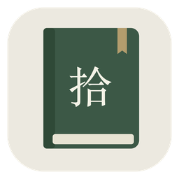
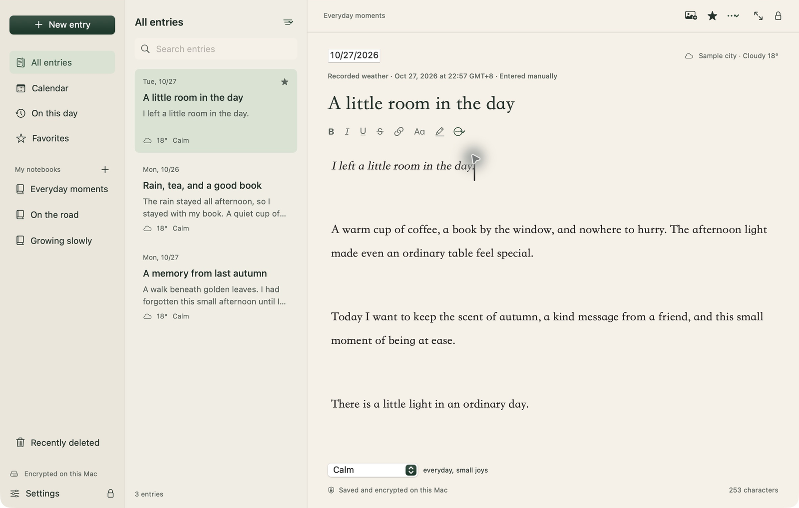
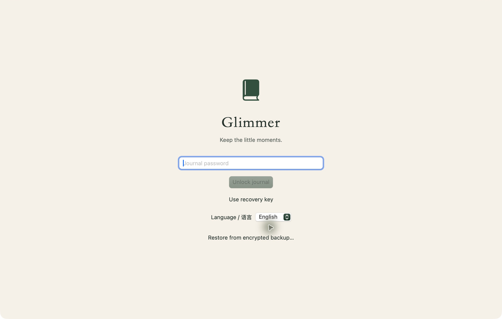
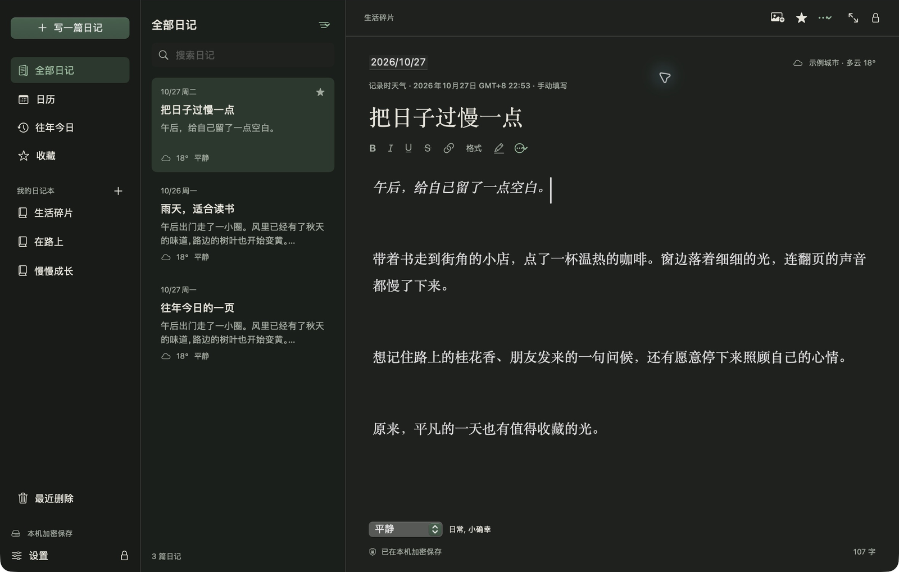

<p align="center">
  
</p>

<h1 align="center">Glimmer · 拾光</h1>

<p align="center"><strong>Keep the little moments.</strong><br>macOS 14+ · Apple Silicon · Local encryption · Private journaling<br><a href="https://github.com/stevenflyai/Glimmer-diary/releases/download/v1.1.2/Glimmer-1.1.2-AppleSilicon.dmg"><strong>Download for macOS · v1.1.2</strong></a> · <a href="https://github.com/stevenflyai/Glimmer-diary/releases/tag/v1.1.2">Release notes</a></p>

<p align="center">
  <a href="README.md">简体中文</a> · <strong>English</strong>
  · <a href="#features">Features</a> · <a href="#privacy-and-encryption">Privacy</a> · <a href="#install-and-get-started">Install</a> · <a href="#build-from-source">Build</a>
</p>

**Glimmer is a native macOS app for keeping a private journal.** Collect everyday moments in words and photos, on a warm ivory page with quiet green accents. Write without an account, keep writing offline, and store your entries in encrypted form on your own Mac.



<p align="center"><sub>Actual app interface from version 1.1.2. All previews use entries prepared specifically for these screenshots.</sub></p>

## A little space for yourself

- **A calm place to write.** Warm paper colors, generous space, serif typography, dark appearance, and a focus mode that lets your words take center stage.
- **A journal that feels personal.** No account to create or social feed to maintain. Keep a mood, a photo, or a small thought without preparing it for an audience.
- **Local storage, with encryption.** Password protection, optional Touch ID, automatic locking, an encrypted database, and separately encrypted original images.
- **Memories you can keep and take with you.** Encrypted backups, entry history, and PDF or Markdown export give you practical ways to preserve your writing.

## Features

| What you want to do | What Glimmer offers |
| --- | --- |
| Capture a day | Autosave, multiple entries per day, backdated entries, Chinese and English text input |
| Make the page your own | Bold, italic, underline, strikethrough, links, text colors, highlights, fonts and sizes; bullets, quotes, and dividers |
| Keep a photo with a thought | Insert, drag, or paste JPEG / PNG / HEIC images; write alongside them; double-click to enlarge |
| Organize your everyday life | Notebooks, moods, tags, favorites, and local full-text search |
| Revisit a memory | Calendar browsing, On This Day, version history, and a 30-day Recently Deleted folder |
| Remember the weather | Optional automatic weather, city search, or manual weather notes; past entries keep their recorded weather |
| Step away from your desk | Password or optional Touch ID unlock; automatic locking after inactivity, screen lock, or sleep |
| Back up or export | Encrypted backup and restore; export an entry or the current list as PDF or Markdown with images |
| Build a gentle routine | Optional daily reminders with generic notification text |
| Use your preferred language | Switch between English and Simplified Chinese from the sign-in screen or Settings; existing writing and notebook names stay as written |

Images support up to 50 MB each and 20 files per import. Markdown exports use inline HTML for underlines and colors; rendering depends on your reader's HTML/CSS support.

## A closer look

### Your writing stays behind a lock



### A quiet page after dark



The [Chinese README](README.md) also includes a preview of the light interface in Simplified Chinese.

## Privacy and encryption

### Your journal lives on your Mac

Writing, reading, and searching work offline. The current version has no cloud account or built-in cloud sync, and does not upload journal text. Release builds use the macOS App Sandbox. Search runs inside the unlocked app and does not index your entries in Spotlight.

| What is protected | Current implementation |
| --- | --- |
| Entries and journal information | Titles, text, dates, moods, tags, weather, search fields, image previews, and version history are stored in a **SQLCipher-encrypted database** |
| Original images | Separately encrypted with **AES-256-GCM**; random attachment filenames contain neither entry titles nor original photo names |
| Passwords and keys | libsodium **Argon2id** with 64 MiB of memory and an operation limit of 3 derives the password key, which wraps a randomly generated 256-bit master key; **HKDF-SHA256** derives keys for separate purposes |
| Device unlock | Optional Touch ID, with a device unlock key protected by macOS Keychain access controls tied to the current biometric set |
| Access when you step away | Locks after 5 minutes of inactivity by default, on screen lock, or on sleep; locking when switching apps is optional |
| Backup and recovery | Backups retain the encrypted database and images; restoration verifies the backup manifest and file integrity |

Default data location for the sandboxed app:

```text
~/Library/Containers/com.shiguang.diary/Data/Library/Application Support/Shiguang/
```

The English product name is **Glimmer**. Internal identifiers and the `Shiguang` data directory are retained for compatibility with existing installations.

### Weather is an optional network feature

Weather lookup is off by default. When enabled, relevant foreground actions can request system location access. Coordinates are rounded to a **0.05° grid** before being sent to Open-Meteo and to Apple for place-name lookup. Entries retain the city and weather, not precise coordinates. These services still receive an approximate location and network IP; city search sends the city name you enter to Open-Meteo.

You can decline location access, keep writing offline, and enter weather manually. Weather comes from forecast models and may differ from conditions on your street. See the [Open-Meteo terms and privacy information](https://open-meteo.com/en/terms) and the [CC BY 4.0 data license](https://creativecommons.org/licenses/by/4.0/).

### Take care of your keys, backups, and exports

Keep your recovery key somewhere safe outside the app. If you lose your password, recovery key, and all usable device-unlock methods, the developer cannot recover your old entries. Changing a password does not update existing backups; an older backup may still require its original password or recovery key.

Encryption protects app data stored on disk. Content visible while the app is unlocked, photos already in your photo library, and PDF or Markdown files you choose to export need their own protection. Glimmer does not promise to erase historical copies from SSDs, Time Machine, or external backups, and has not undergone an independent security audit.

## Install and get started

**Current version: 1.1.2 · Apple Silicon (M-series Macs) · macOS 14 or later**

1. [Download the installer (v1.1.2 · Apple Silicon)](https://github.com/stevenflyai/Glimmer-diary/releases/download/v1.1.2/Glimmer-1.1.2-AppleSilicon.dmg), or visit [Releases](https://github.com/stevenflyai/Glimmer-diary/releases) for release notes and SHA-256 checksums. You can also build from source below.
2. Quit any running older version, open the disk image, and drag the app into Applications. Updates continue to use your existing password and entries.
3. On first launch, choose a password of at least 10 characters. A unique, long passphrase is recommended. Save your recovery key and confirm its last eight characters.
4. Choose **New entry** and start writing. Glimmer saves after a pause of about a second; `⌘S` saves immediately.
5. Choose a backup location under **Settings → Backups**. An external disk or another independent location helps protect against drive failure.

Current builds use an ad-hoc local signature and **are not signed with an Apple Developer ID or notarized**. macOS may block opening a downloaded build; building from source is an alternative. An Intel installer is not currently provided. The disk image and app bundle may retain the Chinese name `拾光`.

### Keyboard shortcuts

| Shortcut | Action |
| --- | --- |
| `⌘N` / `⌘S` | New entry / Save now |
| `⌘B` / `⌘I` / `⌘U` | Bold / Italic / Underline |
| `⌘K` | Add or edit a link |
| `⌘` + click a link | Open the link |
| `⌘F` / `⌘⇧F` | Search entries / Focus mode |
| `⌘⇧L` | Lock journal |
| `⌘,` | Open Settings |

## Build from source

You need an Apple Silicon Mac running macOS 14 or later, a Swift 6 toolchain through Xcode or Command Line Tools, and Python 3. Cryptographic dependencies are included in the source tree; a normal build does not download additional dependencies.

Download or clone the source and open a terminal in the project root containing `Package.swift`:

```sh
./build.sh
```

The app is written to `dist/拾光.app`. The default is a Release build with sandbox entitlements and an ad-hoc signature. Use `SHIGUANG_BUILD_DIR` and `SHIGUANG_OUTPUT_DIR` to choose different build and output directories.

Run the core regression checks:

```sh
./test.sh
```

<details>
<summary>Development and verification notes</summary>

- Use `SHIGUANG_CONFIGURATION=debug ./build.sh` for a debug build.
- Use `SHIGUANG_CONFIGURATION=release ./test.sh` to run core checks in an optimized build.
- Tests use a separate data directory. Debug-only `--ui-test` mode requires an isolated `SHIGUANG_DATA_DIR` before creating a fixture vault. Release builds exclude the test entry points and fixture passwords.
- Native checks include `--ime-checks`, `--format-checks`, and `--export-checks`. A test app running alongside the regular app should have a different bundle identifier and be re-signed.
- The included libsodium static library is arm64. Intel builds need a library built for that architecture.
- A ManifestAPI compatibility adjustment for certain macOS 27 Command Line Tools versions applies only to copies inside the build directory; it does not alter the system toolchain.

</details>

## Project structure and verification

```text
Sources/Shiguang/       SwiftUI views, AppKit editor, and macOS integration
Sources/DiaryCore/      Encrypted vault, models, backups, and weather requests
Sources/CSQLCipher/     Official SQLCipher source
Sources/CVaultCrypto/   libsodium Argon2id interface
Tests/DiaryCoreTests/   Core regression checks
Resources/             App icon, metadata, and sandbox entitlements
Vendor/                Static dependencies and provenance
docs/images/           README screenshots
```

Checks on Apple Silicon / macOS 27.0.1 cover core encryption, backup restoration, rich text persistence, Chinese input, image and document export, and bilingual UI. The full set of Touch ID, location permission, notification, and OS-version combinations still needs testing on the corresponding devices. See the [validation record](VALIDATION.md) and [changelog](CHANGELOG.md), currently maintained in Chinese.

The current version focuses on a local Mac journal. **iCloud sync, iPhone/iPad apps, audio recording, OCR, and AI features are not currently included.**

## Author and feedback

**Steven Lian** · [stevenlian2981@gmail.com](mailto:stevenlian2981@gmail.com)

Questions, bug reports, and suggestions are welcome through GitHub Issues. Include the app version, macOS version, and steps to reproduce a problem. Use examples without private journal content in screenshots or logs. Please contact the author by email for security issues.

## Dependencies and licensing

- [SQLCipher](https://www.zetetic.net/sqlcipher/) 4.19.0 for encrypted SQLite storage.
- [libsodium](https://libsodium.org/) 1.0.22 for Argon2id password derivation.
- Apple SwiftUI, AppKit, CryptoKit, Keychain, and LocalAuthentication.

Third-party notices are in [Licenses](Licenses/); dependency sources and checksums are recorded in [Vendor/PROVENANCE.md](Vendor/PROVENANCE.md). **A project-level open-source license for the application code has not yet been specified.**
