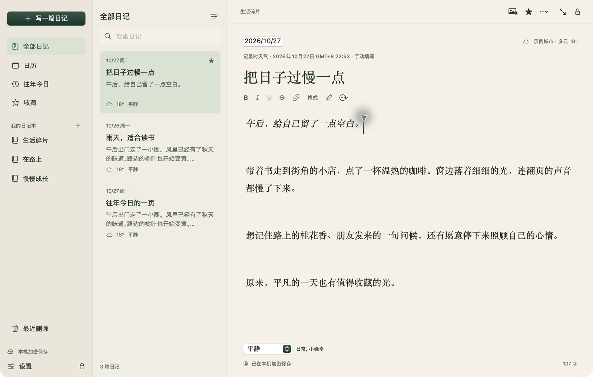
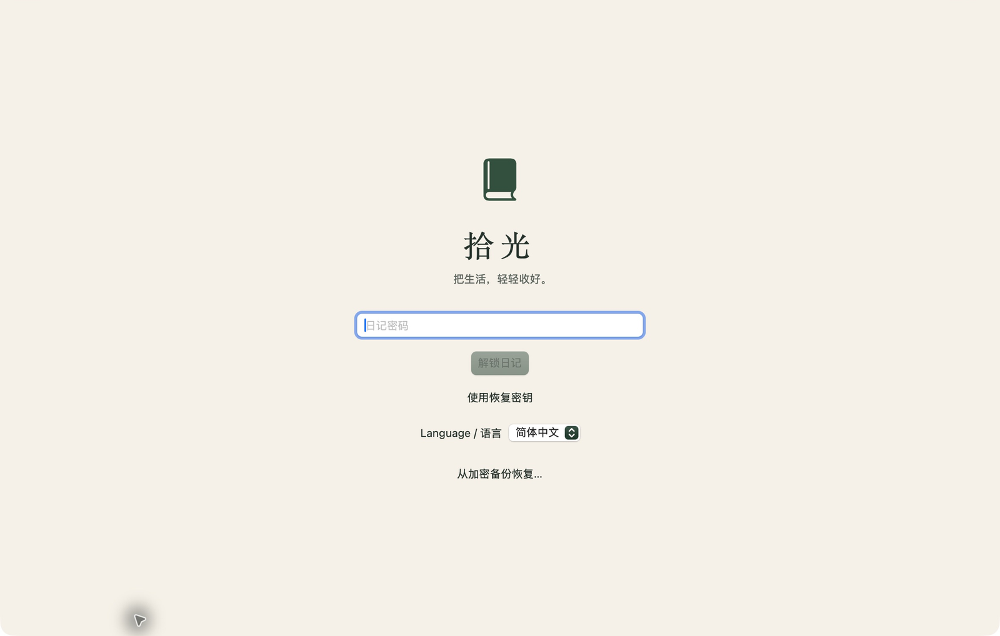

<p align="center">
  
</p>

<h1 align="center">拾光 · Glimmer</h1>

<p align="center"><strong>把生活，轻轻收好。</strong><br>macOS 14+ · Apple Silicon · 本机加密 · 私人日记<br><a href="https://github.com/stevenflyai/Glimmer-diary/releases/download/v1.1.2/Glimmer-1.1.2-AppleSilicon.dmg"><strong>下载 macOS 版 · v1.1.2</strong></a> · <a href="https://github.com/stevenflyai/Glimmer-diary/releases/tag/v1.1.2">版本说明</a></p>

<p align="center">
  <strong>简体中文</strong> · <a href="README.en.md">English</a>
  · <a href="#功能">功能</a> · <a href="#安全与隐私">安全与隐私</a> · <a href="#安装与开始">安装</a> · <a href="#从源码构建">构建</a>
</p>

**拾光是一款清新、安静的原生 macOS 私人日记软件。** 用文字和照片收藏生活的小片刻，在米白纸面与墨绿色的安静界面里，写下只属于自己的故事。无需注册账号，离线也能书写；日记以加密形式保存在自己的 Mac 上。



<p align="center"><sub>当前版本 1.1.2 的实际界面。所有预览均使用专门准备的示例日记。</sub></p>

## 为自己留一页

- **清新而安静。** 温暖纸感、自然留白、宋体书写，支持深色外观与专注模式，让注意力回到眼前的一段话。
- **私人而自在。** 无需账号，不内置社交动态；用心情、标签和照片记录日常，不必考虑如何展示给别人。
- **本机保存，也认真加密。** 密码保护、可选 Touch ID、自动锁定、加密数据库与加密图片，共同保护存下来的片刻。
- **回忆可以带走。** 提供加密备份、历史版本，以及 PDF / Markdown 导出，让整理与留存都有自己的选择。

## 功能

| 你想做的事 | 拾光可以帮你 |
| --- | --- |
| 随手记下今天 | 自动保存；同一天写多篇；补写过去的日期；中文、英文输入 |
| 写得更有自己的样子 | 粗体、斜体、下划线、删除线、超链接、文字颜色、背景高亮、字体与字号；列表、引用、分隔线 |
| 留住一张照片 | 插入、拖入或粘贴 JPEG / PNG / HEIC；在照片旁写下文字；双击放大 |
| 整理生活的不同侧面 | 多个日记本、心情、标签、收藏、本机全文搜索 |
| 找回过去的片刻 | 日历浏览、往年今日、历史版本；最近删除保留 30 天 |
| 为一天留下天气 | 可选自动天气、城市搜索或手动记录；回看旧日记不刷新当时的天气 |
| 放心离开书桌 | 密码或可选 Touch ID 解锁；闲置、锁屏、睡眠时自动锁定 |
| 保存和迁移记录 | 加密备份与恢复；导出当前日记或当前列表为 PDF / Markdown 加图片 |
| 养成自己的节奏 | 可选每日提醒，通知只显示通用文案 |
| 使用熟悉的语言 | 登录页和设置中切换简体中文 / English，保留原有日记内容与日记本名称 |

图片每张最多 50 MB，每批最多 20 张。Markdown 导出的下划线和颜色使用内联 HTML，显示效果取决于阅读器的 HTML/CSS 支持。

## 更多界面

### 夜晚，也可以安静地写


### 写给自己的话，先解锁再看



英文界面与英文示例日记可在 [English README](README.en.md) 中查看。

## 安全与隐私

### 日记保存在你自己的 Mac 上

书写、阅读和搜索可以离线完成。当前版本不提供云端账号或内置云同步，也不上传日记正文。正式构建启用 macOS App Sandbox，搜索只在解锁后的应用内进行，不接入 Spotlight。

| 保护对象 | 当前实现 |
| --- | --- |
| 正文与日记信息 | 标题、正文、日期、心情、标签、天气、搜索字段、图片预览和历史版本存储在 **SQLCipher 加密数据库**中 |
| 原始图片 | 使用 **AES-256-GCM** 独立加密；随机附件文件名不含日记标题或原始照片名 |
| 密码与密钥 | 使用 libsodium **Argon2id**（64 MiB、3 次计算）派生密码密钥，包装随机生成的 256 位主密钥；使用 **HKDF-SHA256** 派生不同用途的子密钥 |
| 设备解锁 | 可选 Touch ID；设备解锁密钥受 macOS Keychain 与当前指纹集访问控制保护 |
| 离开应用后的访问 | 默认闲置 5 分钟锁定；锁屏、睡眠时锁定；可开启切换应用立即锁定 |
| 备份与恢复 | 备份保留加密数据库和加密图片，恢复前验证备份清单与内容完整性 |

默认沙盒数据目录：

```text
~/Library/Containers/com.shiguang.diary/Data/Library/Application Support/Shiguang/
```

英文品牌名是 **Glimmer**；内部应用标识和数据目录保留 `Shiguang`，便于已有版本继续读取原有日记。

### 天气是可选的联网功能

天气查询默认关闭。开启后，应用在相关前台操作中请求系统定位，将坐标降低到 **0.05° 网格**后发送给 Open-Meteo，并由 Apple 解析地名；日记只保存城市与天气，不保存精确坐标。服务方仍会接收到近似位置及网络 IP；搜索城市时，输入的城市名会发送给 Open-Meteo。

拒绝定位或没有网络时，仍能正常写日记，也可以手动填写天气。天气来自气象模型，可能与实际街道天气不同。详见 [Open-Meteo 条款与隐私](https://open-meteo.com/en/terms)及 [CC BY 4.0 数据许可](https://creativecommons.org/licenses/by/4.0/)。

### 密码、备份和导出需要一起照顾

请在应用之外安全保存恢复密钥。密码、恢复密钥及可用的设备解锁途径全部丢失后，开发者无法替你恢复旧日记。修改密码不会更新旧备份，恢复旧备份可能仍需要当时的密码或恢复密钥。

加密保护的是磁盘上的应用数据；解锁后显示的内容、原本保存在照片图库中的图片，以及主动导出的 PDF / Markdown 文件，需要你自行管理。应用不承诺擦除 SSD、Time Machine 或外部备份中的历史副本，也不声称已经过独立安全审计。

## 安装与开始

**当前版本：1.1.2 · Apple Silicon（M 系列）· 最低 macOS 14**

1. [下载安装包（v1.1.2 · Apple Silicon）](https://github.com/stevenflyai/Glimmer-diary/releases/download/v1.1.2/Glimmer-1.1.2-AppleSilicon.dmg)，或在 [Releases](https://github.com/stevenflyai/Glimmer-diary/releases) 查看版本说明和 SHA-256 校验文件；也可以按下文从源码构建。
2. 退出正在运行的旧版，打开安装包，将“拾光”拖入“应用程序”。升级后继续使用原密码和原有日记。
3. 首次打开时设置至少 10 个字符的密码，推荐使用独特的长短语；保存恢复密钥并核对最后 8 位。
4. 点击“写一篇日记”，记录第一句话。停顿约一秒后自动保存，也可以按 `⌘S` 立即保存。
5. 在“设置 → 备份”中选择备份位置。建议将加密备份另存到外置磁盘等独立位置。

当前构建采用本地签名，**尚未经过 Apple Developer ID 签名与公证**，macOS 可能阻止直接打开；如安装受系统限制，可从源码构建。当前未提供 Intel 安装包。

### 常用快捷键

| 快捷键 | 操作 |
| --- | --- |
| `⌘N` / `⌘S` | 新建日记 / 立即保存 |
| `⌘B` / `⌘I` / `⌘U` | 粗体 / 斜体 / 下划线 |
| `⌘K` | 添加或编辑链接 |
| `⌘` + 单击链接 | 打开链接 |
| `⌘F` / `⌘⇧F` | 搜索日记 / 专注模式 |
| `⌘⇧L` | 锁定日记 |
| `⌘,` | 打开设置 |

## 从源码构建

需要一台 Apple Silicon Mac、macOS 14+、Swift 6 工具链（Xcode 或 Command Line Tools）及 Python 3。加密依赖已随源码提供，普通构建不下载额外依赖。

下载或克隆源码，进入包含 `Package.swift` 的项目根目录：

```sh
./build.sh
```

应用生成在 `dist/拾光.app`。默认构建为 Release，包含沙盒配置与本地签名；`SHIGUANG_BUILD_DIR` 和 `SHIGUANG_OUTPUT_DIR` 可分别指定构建目录与输出目录。

运行核心回归检查：

```sh
./test.sh
```

<details>
<summary>开发与验证说明</summary>

- `SHIGUANG_CONFIGURATION=debug ./build.sh` 可构建调试版。
- `SHIGUANG_CONFIGURATION=release ./test.sh` 可运行优化构建的核心检查。
- 测试数据使用单独目录。Debug 版的 `--ui-test` 必须同时指定隔离的 `SHIGUANG_DATA_DIR`，才会创建示例保险库；正式版不包含测试入口和测试口令。
- Debug 专用检查包括 `--ime-checks`、`--format-checks`、`--export-checks`。与正式应用并行运行时，测试包应使用不同的 bundle identifier 并重新签名。
- 当前随附的 libsodium 静态库为 arm64；Intel 构建需要另外提供对应架构的库。
- 针对部分 macOS 27 Command Line Tools 的 ManifestAPI 兼容处理只作用于构建目录内的副本，不修改系统工具链。

</details>

## 项目结构与验证

```text
Sources/Shiguang/       SwiftUI 界面、AppKit 编辑器与 macOS 系统集成
Sources/DiaryCore/      加密保险库、数据模型、备份与天气请求
Sources/CSQLCipher/     SQLCipher 官方源码
Sources/CVaultCrypto/   libsodium Argon2id 接口
Tests/DiaryCoreTests/   核心回归检查
Resources/             应用图标、元数据与沙盒声明
Vendor/                静态依赖与来源记录
docs/images/           README 界面预览
```

已在 Apple Silicon / macOS 27.0.1 上完成核心加密、备份恢复、富文本持久化、中文输入、图文导出与双语界面检查。Touch ID、定位权限、通知及不同系统版本的完整组合仍需对应设备验证。详情见 [验证记录](VALIDATION.md)与 [更新记录](CHANGELOG.md)。

当前版本专注本机日记；**iCloud 同步、iPhone/iPad 版本、录音、OCR 和 AI 功能尚未提供**。

## 作者与反馈

**Steven Lian** · [stevenlian2981@gmail.com](mailto:stevenlian2981@gmail.com)

欢迎通过 GitHub Issues 提交问题和建议。反馈问题时，请提供应用版本、macOS 版本与复现步骤；示例截图和日志请使用不含私人日记的内容。安全问题可通过邮箱联系作者。

## 依赖与许可

- [SQLCipher](https://www.zetetic.net/sqlcipher/) 4.19.0：基于 SQLite 的加密数据库。
- [libsodium](https://libsodium.org/) 1.0.22：提供 Argon2id 密码派生。
- Apple SwiftUI、AppKit、CryptoKit、Keychain 与 LocalAuthentication。

第三方许可见 [Licenses](Licenses/)，来源与校验值见 [Vendor/PROVENANCE.md](Vendor/PROVENANCE.md)。**项目应用代码尚未指定开源许可证。**
